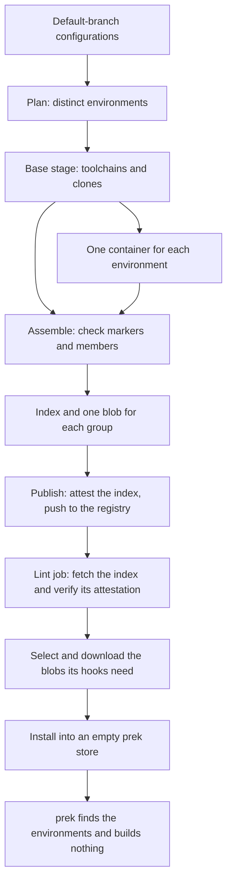

<!--
# SPDX-License-Identifier: Apache-2.0
# SPDX-FileCopyrightText: 2026 The Linux Foundation
-->

# Design

This document describes what a hook bundle is, how this repository
builds one, and what stops a bundle from becoming a way into every
repository that uses it. It describes the code as it stands; the
[last section](#not-built-yet) lists what does not exist yet.

## The problem

The organisation is replacing pre-commit.ci with a linting workflow
that an organisation ruleset runs on every pull request. Each lint job
starts on a fresh runner, and prek builds the environment of every hook
it runs: it clones the hook's repository, creates a virtual environment
or a `node_modules` tree, and installs packages from PyPI, npm or the Go
module proxy.

`actions/cache` cannot remove that work, for two reasons that are
properties of GitHub and not of our configuration:

- A cache belongs to one repository. No setting shares one between
  repositories.
- A `pull_request` run saves its cache under `refs/pull/N/merge`, where
  nothing but re-runs of that pull request can read it. A ruleset
  workflow runs on `pull_request` and nothing else, so no run ever saves
  a cache on the default branch, where other pull requests could read
  it.

A survey of the 152 active repositories on 26 November 2026 found the
other half of the picture. They carry 100 distinct configuration files,
so a cache keyed on the file would miss even where sharing was
possible. Two or more repositories share 30 distinct hook environments,
and the 16 from `actions-template` account for 91% of all uses. The
work repeats across the estate, and what repeats is the environment,
not the configuration.

## What prek reuses

The design rests on how prek 0.4.14 decides that it already has an
environment. The source is the authority for each statement here, and
the build workflow tests the outcome on every run.

- prek keeps a store, by default `~/.cache/prek`, with `repos/` (one
  clone a hook repository and revision), `hooks/` (one directory an
  environment) and `tools/` (toolchains prek downloaded).
- Each environment holds a marker, `.prek-hook.json`. To reuse an
  environment prek compares the marker with what a hook asks for: the
  language, the hook repository's URL and revision, the extra
  dependencies in order, and the language version requested. The
  directory name plays no part.
- A marker records absolute paths, as do a virtual environment's
  scripts and links. An environment works at the path where prek built
  it and nowhere else.
- prek checks a Python or Node.js environment's health by running its
  interpreter and comparing the version with the marker. An
  environment that fails the check is not an error: prek ignores it and
  builds a new one.
- For a toolchain, prek looks in its own `tools/` first, then on the
  runner, then downloads. A store that already holds a toolchain
  decides which one every environment uses.

Two consequences follow. A store built elsewhere works on a runner when
it sits at the same path and brings its toolchains with it. And whoever
writes a marker decides which hook the environment serves, which is why
the builder never takes a marker on trust.

## Overview

A bundle is an index, `index.json`, and a directory of blobs. Each blob
is a compressed tar of one group: one toolchain, one clone or one
environment. A blob takes its name from the SHA-256 of its bytes. The
index names every blob and records the requirements each environment
answers, so a lint job fetches the blobs its own hooks need, and one
attestation over the index vouches for every blob.

## Planning

`hookbundles/plan.py` reads each repository's default-branch
`.pre-commit-config.yaml` as data and reduces every hook to the
requirements prek would compute for it: the five values listed above.
A set of requirements that enough repositories share becomes a *unit*.
`bundle.toml` sets the threshold, and names repositories whose hooks
skip it: the canonical configuration in `actions-template`.

The planner refuses, and reports, what it cannot reproduce:

- a `rev` that is not a full commit id. A tag can move, so two builds
  from one could differ;
- a hook repository that is not an `https://` URL;
- a language the base stage does not seed. Hooks in such a language
  build on the runner, as they do today;
- `default_language_version`, which changes what a hook asks for in a
  way the planner cannot see before it has a clone of the hook
  repository. No repository sets it today.

A local hook with no dependencies needs no unit: the base stage builds
that environment for each language it seeds.

## Building

An environment's build runs whatever the hook repository's packaging
runs: a `setup.py`, an npm install script, a Go build. That code comes
from outside the organisation, and the result will run in every
repository's lint job. `hookbundles/sandbox.py` splits the build into a
stage that runs no hook code and stages that run nothing else.

**The sandbox image** (`sandbox/Dockerfile`) is the distribution
release of the runner image, with git, uv and prek, the user and home
directory of a hosted runner, and no language toolchain. prek then has
to download every toolchain into its own store, so no environment can
depend on something that the image alone has.

**The base stage** runs once. It installs the Python that `bundle.toml`
pins into the store, installs a seed configuration of local hooks that
have no dependencies, and runs `prek list` against each unit to clone
its repository. `prek list` reads a repository's manifest and installs
nothing. The stage leaves the toolchains, the clones and the seed
environments, and the builder commits that state as an image.

**Each unit** then builds in a container of its own, started from that
image and removed afterwards. The container has no capabilities, cannot
gain privileges and receives nothing but the unit's configuration. When
it exits, the builder saves its `hooks/` directory as a tar stream and
keeps nothing else. A unit can read the toolchains and clones. It
cannot change the copies that go into the bundle, and it never sees
another unit's environment.

An earlier draft gave each unit a workflow job. One container for each
unit, driven by one job, replaced it for two reasons. Jobs hand their
output to the next job as run artifacts, and a job that reads the
runner's artifact token can replace another job's artifact, so the
isolation would have depended on that token staying out of reach.
Containers also make the whole build runnable on a laptop, where the
design had its first trial. The cost is that a
container is a weaker wall than a virtual machine: a kernel or container
runtime escape would let one unit reach the others. The job that runs
the sandbox holds no secret and no write permission, so an escape gains
the ability to alter the bundle and nothing more.

## Assembly

`hookbundles/assemble.py` decides what a bundle contains. It reads the
tar streams the sandbox saved and writes blobs, copying members from
one archive to another. It extracts nothing and runs nothing.

It takes toolchains, clones and seed environments from the base stage's
export alone. From a unit's archive it takes environment directories
that the base stage did not have, and nothing else, and it accepts one
when each of these holds:

- the marker names the unit's own hook repository and revision, or
  names none for a local unit;
- the marker's dependencies are the unit's, where the unit states any.
  A remote hook that states none takes its repository's defaults, which
  the repository's own manifest sets;
- the marker's `env_path` is the directory it sits in;
- the marker's toolchain lies inside a toolchain the base stage
  installed.

Those checks carry the security of the whole design. A unit's install
code controls everything inside its own environment, as it does when
prek builds that environment on a runner today. It cannot produce an
environment that prek would select for any other hook, because prek
selects by the marker and the assembler has compared the marker with
the unit.

Every member of every archive must also pass the rules in
`hookbundles/archive.py`:

- a member is a regular file, a directory or a symbolic link. The
  assembler refuses hard links, devices and FIFOs;
- a name is relative and has no `.` or `..` component;
- a symbolic link resolves inside the store: an environment's links may
  reach its own directory and `tools/`, a clone's links its own
  directory;
- no member's path passes through a symbolic link, which is what makes
  checking a link's target by its text sound;
- a blob carries no set-user-id, set-group-id or sticky bit, no
  ownership and no extended header.

The assembler leaves out a unit that breaks any rule and reports it in
the index. The lint job then builds that environment itself.

## Publishing

The build workflow publishes a bundle after it has proved it (see
[Measurements](#measurements)), and from the default branch alone.

The publish job holds the workflow's write permissions: `packages:
write`, `id-token: write` and `attestations: write`. It checks out
nothing and runs none of this repository's code. It runs pinned
actions and a short shell script, in four steps:

1. It downloads the index and the blobs by the artifact ids the build
   job reported, not by name. The lint jobs that prove a bundle run
   hook code on their runners, between the build and the publish. A job
   that replaced an artifact would give it a new id, and the publish job
   would not fetch it.
2. It checks that the blobs present are the blobs the index names, and
   that each hashes to its name.
3. It attests the index with `actions/attest-build-provenance`. The
   attestation is a Sigstore bundle whose certificate names this
   repository, the workflow file and the git ref.
4. It pushes the index, the attestation and the blobs to the GitHub
   Container Registry with ORAS, as one OCI artifact.

The tag names what the bundle serves: runner image, architecture and
prek release, for example `ubuntu24-x86_64-prek0.4.14`. A lint job asks
for the tag that matches it, and a job that no bundle serves finds no
tag.

GHCR won over release assets for two reasons. Pushing needs
`packages: write`, which reaches nothing but the package, where a
release needs `contents: write`. And a registry addresses a blob by
its digest, which is the name the index already gives it. One step
may fall to a person: the organisation's settings decide whether a new
package is public, and the package's settings page is the one place
that changes a private one. The publish job tries a pull without a
token on every run, and warns when it fails. In the fork where this
was first run, the package was public from its first push.

The registry is transport. The lint job believes nothing it serves:
the index must carry a valid attestation, and a blob must hash to the
digest the index gives.

## Installing

`hookbundles/pull.py` is what a lint job runs, through this repository's
action (`action.yaml`) or the `pull` command. Its order is the security
argument:

1. Find the bundle by tag. No tag means no bundle serves this job.
2. Download the index and the attestation.
3. Verify the attestation with `gh attestation verify`. The index must
   come from this repository's `build.yaml`, run on `refs/heads/main`,
   on a GitHub-hosted runner. The attestation travels with the bundle,
   and the check needs no GitHub API call and no token.
4. Read the index, and check that it fits the runner.
5. Select blobs: compare the requirements in the job's own
   configuration, optionally limited to the hooks the job runs, with
   the requirements in the index. The selection is the matching
   environments, their clones and their toolchains.
6. Download each selected blob by the digest the index gives, and
   check it against that digest.
7. Install.

Before step 3 the code reads nothing from the registry but the
manifest's list of layers. If verification fails it fetches no blob and
writes nothing.

The action takes the publisher to be the repository that supplied the
action's own code. A caller pins the action by commit, and that pin is
the root of trust: no input changes who must have signed the index.
The action runs the code as `python3 -I` with a `PATH` of system
directories, so the
checkout under review can supply neither a module nor the `python3`,
`gh` or `zstd` that the installer runs.

`hookbundles/install.py` uses the standard library alone. It refuses
to guess:

- The bundle must fit. The index records the prek release, the store
  path, the runner image and the architecture of its build. If any
  differs, the installer writes nothing.
- The store must be empty. The installer never merges into a store
  that something else filled.
- A blob must hash to its name, the index must name it, and it may
  write inside the one group the index assigns it and nowhere else.
- Every member must pass the rules the assembler applied. The
  installer applies them again, with no knowledge of the assembler.

If a blob breaks a rule, the installer removes what it wrote.

A bundle never fails a lint job that could have run without it. The
action reports one of four outcomes and, unless the caller sets
`required`, succeeds in each:

| Status | Meaning | Exit status of `pull` |
| --- | --- | --- |
| `installed` | prek will find the environments | 0 |
| `not-applicable` | No bundle serves this runner and prek release | 3 |
| `unverified` | The index failed verification; error annotation | 4 |
| `failed` | The fetch or the install went wrong | 1 |

Selecting blobs needs a YAML parser, and the action uses the PyYAML
that the runner image's `python3` carries. A runner without it gets
`not-applicable`.

## Threats and controls

<!-- markdownlint-disable MD013 -->

| Threat | Control | What remains |
| --- | --- | --- |
| A pull request plants content that other runs execute | Lint jobs install a bundle and never write one. This repository's builder alone produces one | None from pull requests |
| A hook's install code replaces another hook's environment | One container for each unit; the assembler binds each environment to its unit by the marker | A container escape |
| A hook's install code replaces a toolchain or a clone | Toolchains and clones come from the base stage's export, whatever a unit's archive holds | A container escape |
| A hook's install code tampers with its own environment | None, and none today: the same code builds the same environment on the runner | Each hook repository holds trust for its own hook, as now |
| An archive writes outside the store | Member rules, applied by the assembler and again by the installer | None known |
| Someone alters a bundle in the registry | The index must carry this repository's attestation; a blob must hash to the digest the index gives | An older, validly signed bundle put back under the tag |
| Another workflow, branch or fork publishes a bundle | The attestation's certificate must name `build.yaml` on `refs/heads/main` of the publishing repository | Whoever can push to that branch |
| A job in the build workflow swaps the bundle before publishing | The publish job fetches artifacts by the ids the build job reported, and checks blobs against the index | None known |
| A bundle for another image misbehaves | The installer checks prek release, path, image and architecture | A runner image update between builds; prek's health check then rebuilds |
| A moved tag changes what a revision means | The planner builds full commit ids and nothing else | None |

<!-- markdownlint-enable MD013 -->

Two properties limit the damage if a control fails. A lint job that
uses a bundle holds `contents: read` and no secret, and the design
keeps bundles out of any job that can publish or release. And a bundle
is replaceable: deleting it returns every job to building its own
environments.

## Measurements

The build workflow measures each bundle on hosted runners. These
figures come from its first run, on 26 November 2026, on `ubuntu-24.04`
`x86_64` runners, for the 30 units the survey planned. Both lint jobs
ran `prek run --all-files` on this repository, whose configuration is
the canonical one.

<!-- markdownlint-disable MD013 -->

| Measure | Result |
| --- | --- |
| Units planned, built and accepted | 30 of 30, as 31 environments plus 4 seeds |
| Sandbox build, four units at a time | 2 min 46 s |
| Assembly, at zstd level 19 | 7 min 50 s |
| Toolchains (Python, Node.js, Go) | 111 MiB to download, 542 MiB installed |
| Clones | 19 MiB to download, 48 MiB installed |
| Environments | 462 MiB to download, 2,021 MiB installed |
| Blobs the canonical configuration selects | 36 blobs, 374 MiB to download |
| Cold lint: `prek run` | 69.4 s, building 16 environments |
| Warm lint: install, then `prek run` | 9.4 s, then 20.0 s, building nothing |
| Hook results, cold against warm | Identical for all 35 hooks |
| Whole job, cold against warm | 83 s against 52 s |

<!-- markdownlint-enable MD013 -->

The warm job's 52 s includes 6 s to download every blob as one run
artifact, 592 MiB, where a lint job would fetch the 374 MiB it selects.

A laptop (Docker Desktop, `aarch64`, 14 cores) gave the figures for
single hooks, which the workflow does not measure:

| Hook alone | Cold | Warm: install, then run |
| --- | --- | --- |
| `aislop` | 11.4 s | 1.8 s, then 2.0 s |
| `gha-workflow-linter` | 11.8 s | 0.5 s, then 11.3 s |

On a hosted runner those two hooks select 92 MiB and 34 MiB of blobs.

Three points stand out.

The mechanism works. With the bundle installed, prek ran all 35 hooks
of the canonical configuration, reported for each what the cold run
reported, and built no environment.

The time saved depends on what a job runs. A job that runs the whole
canonical configuration saves about 40 s of 69 s, before the download.
A job that runs one hook saves less, and a hook such as
`gha-workflow-linter`, which spends its time on the network while it
runs, saves nothing. Repositories that run the hooks under `ci.skip`
alone, the present default, are in that second group.

Size decides the packaging. One archive of everything would be 592 MiB
to download and 2.6 GiB to unpack, most of it environments a given job
never runs. Three variants of `basedpyright` and three of `aislop`
account for half of the unpacked size. Splitting the bundle into one
blob for each group lets a job that runs two hooks fetch about
126 MiB, and makes the cost of a variant that two repositories use
fall on those two.

A lint job that installs a bundle also stops depending on PyPI, npm,
the Go module proxy and each hook's repository being reachable at lint
time, and stops resolving unpinned dependencies afresh on every run.
Those may matter more than the seconds.

## Operating notes

- **prek release.** A bundle serves one prek release, the one in the
  sandbox image, and its tag says which. The reusable linting
  workflow's default has to move with it; a job on another release
  finds no tag and builds cold.
- **Package visibility.** If the publish job warns that the package is
  not public, an organisation owner has to change that, once, in the
  package's settings.
- **Runner image.** `bundle.toml` names the image family and
  `sandbox/Dockerfile` must be the same distribution release, so that
  an environment's compiled parts find the C library of their build.
- **Rolling a hook forward.** A unit is a hook at a revision. When the
  estate moves to a new revision, the bundle serves it once two
  repositories have merged the change and a build has run. Until then
  the affected hook builds cold.
- **Unpinned dependencies.** Where a configuration lists a dependency
  without a version, the bundle holds whatever resolved at build time.
  That matches a cache hit today, and each build refreshes it.
- **Go toolchain.** A Go hook is a compiled binary. In a trial,
  `gitleaks` and `actionlint` both ran with the 228 MiB Go toolchain
  left out of the store. The installer still brings it, because prek
  points `GOROOT` at it. Leaving it out is an optimisation to decide
  on, not one already made.

## Not built yet

- **The lint workflow's side.** The action exists, and this
  repository's workflow uses it. No lint job elsewhere calls it yet.
  That needs a step in the reusable linting workflow, before
  `standalone-linting-action` runs, and that action's own `actions/cache`
  of the store turned off for the job, since the installer wants an
  empty store.
- **Pruning.** Each publish leaves the previous bundle's blobs in the
  registry, untagged. Nothing removes them yet.
- **Rebuilding on change.** The workflow builds daily, on a push and by
  hand. A build when `actions-template` changes its hooks would shorten
  the wait after a hook moves to a new revision.
- **Other runners.** The bundle serves `ubuntu24` on `x86_64`. Arm
  runners and other images each need a build of their own.
- **Egress.** The sandbox job runs harden-runner in audit mode. The
  audit record from its first runs should become a block list.
